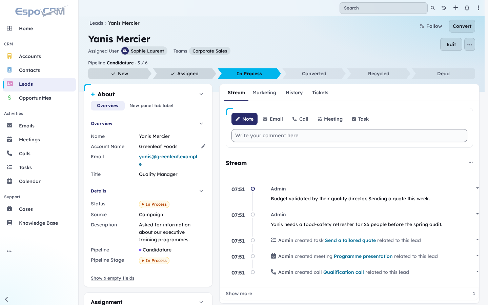
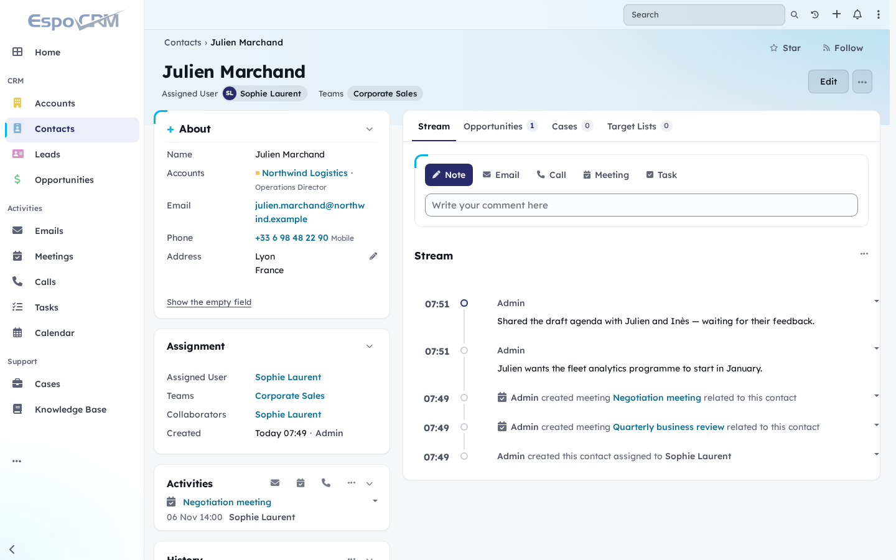
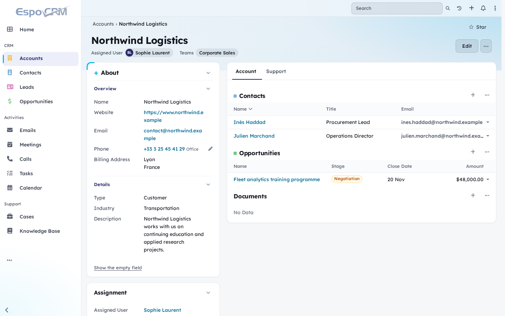
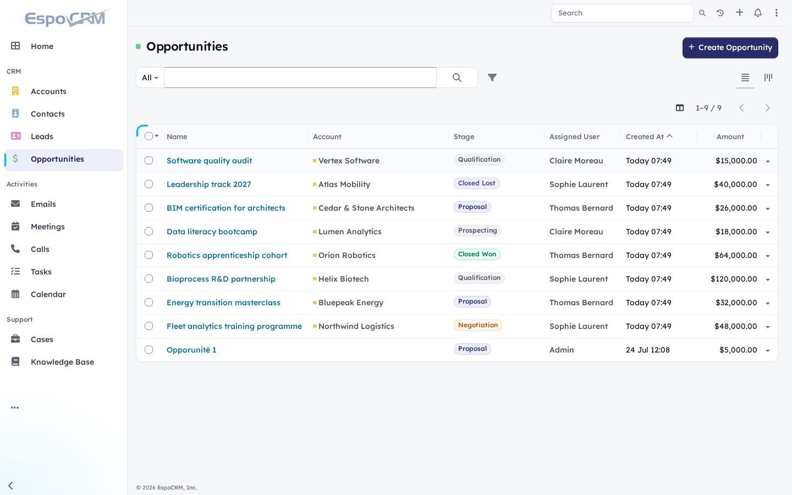
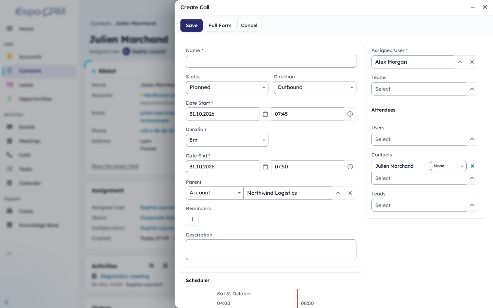

# Lucid — a theme for EspoCRM

Lucid is a light, readable theme for [EspoCRM](https://www.espocrm.com/) with a modern SaaS feel.
It reworks the record view into two columns — static fields on the left, activity on the right —
adds a band with the record's owner and pipeline stages, and makes every block collapsible.
It is built on the UTT palette (Bleu UTT `#292B6B` for actions, cyan `#00B6ED` as the signature
accent) and targets WCAG 2.1 AA / RGAA.



## Screenshots

| | |
|---|---|
|  |  |
| Contact: About card, Assignment card, quick actions and stream | Account: layout panels on the left, relationship tabs on the right |
|  |  |
| List as a card, coloured record links, stage badges | Native EspoCRM side panel, detached from the page |

All data in the screenshots is fictitious.

## Features

- **Record view in two columns.** The **About** card on the left holds the layout panels as a
  compact property list (tab breaks become small pill tabs), followed by an **Assignment** card
  (assigned user, teams, dates, followers) and the Activities, History and Tasks panels. The right
  column starts with the **Stream** tab — quick actions (Note, Email, Call, Meeting, Task) above the
  stream as a timeline — then one tab per relationship panel, with its count.
- **Band** at the top of each record: name, assigned users and teams, record actions and, for
  entities with an active pipeline, the stage path (click a stage to move the record if you may
  edit it).
- **Collapsible blocks.** About, Assignment, the side panels and each layout panel fold like an
  accordion. The state is remembered per user and record type; everything opens while editing.
- **Adjustable column.** A handle between the columns sets the width of About, from 300 to 720 px
  (mouse, or arrow keys / Home / End; double-click to reset). The main column keeps at least 480 px.
- **Empty fields hidden** behind a "Show N empty fields" link, all shown while editing.
- **Readability.** One typeface, Lexend, for text and titles; labels as large as values; record
  links coloured so that what is clickable stands out; comfortable form fields.
- **Light palette.** White sidebar, ice-blue record band, cards with a cyan corner mark. Colours
  are CSS tokens (`--lucid-band-*`, `--lucid-sidebar-*`), easy to retune.
- **Speaks every EspoCRM language.** Labels come from EspoCRM's own translations; only the
  empty-fields link and the Assignment title are the theme's own (English and French).

Knowledge base articles (and any entity with a rich-text `body`) keep their fields in the main
column, full width. Email and User records, and detail views opened in dialogs, keep the EspoCRM
layout. Panel actions, inline editing and access rights are EspoCRM's own.

## Accessibility

- Text contrast of at least 4.5:1 and form field borders of at least 3:1, checked for every colour.
- Visible keyboard focus, including on dark areas; reduced motion when the system asks for it.
- The record name is the page heading; pipeline steps wrap instead of being cut when zoomed.
- The page declares its language and allows zooming on mobile (EspoCRM does neither by default).
- Custom controls (tabs, accordions, column handle) expose their state to screen readers.

Some remaining issues come from EspoCRM's own markup (icon-only buttons, unlabeled list
checkboxes) and are outside the scope of a theme.

## Install

Requires EspoCRM 10.0 or later and PHP 8.3+ (tested on 10.0.3 and 10.0.11).

1. Download `lucid-theme-<version>.zip` from the
   [latest release](https://github.com/AlexisSantin/espocrm-lucid-theme/releases/latest).
2. In EspoCRM: **Administration > Extensions > Upload**, choose the ZIP, then **Install**.
3. Select **Lucid** in **Administration > User Interface > Theme** (default for everyone, also used
   on the login page) or per user in **Preferences**.

Updates install the same way, over the previous version.

### Upgrading from Arc

Lucid was called Arc up to version 0.11.2. Install Lucid Theme, then uninstall Arc Theme. The
install script moves the default theme, user preferences and portals from Arc to Lucid, so
nobody falls back to the EspoCRM theme. Both extensions can coexist without conflict in the
meantime.

## Development

```bash
cd lucid-theme
npm install
npm run sync          # copy src/files into ../site
npm run clear-cache   # after metadata or translation changes
npm run extension     # build build/lucid-theme-<version>.zip
```

- The CSS files imported by `lucid.css` and `lucid-iframe.css` carry `?v=<version>`: bump it
  together with `package.json` on every release so browsers drop stale copies.
- The module is bundled: in production EspoCRM loads `lib/module-lucid-theme.js` through
  `lib/init.js`, listed in `app/client.json` `scriptList`. Developer mode loads the transpiled
  sources instead, so test a release on an instance with developer mode off.
- The record view is applied by a `record/detail` view setup handler that derives the bottom view
  configured for the entity instead of replacing it. If it cannot apply (an unexpected EspoCRM
  version, for instance), the record keeps the EspoCRM layout. The module imports no EspoCRM client
  module, and never uses admin-only translation scopes (they are not sent to regular users).

```
src/files/custom/Espo/Modules/LucidTheme/Resources/
    metadata/themes/Lucid.json          theme parameters, chart and calendar colours
    metadata/app/client.json            lib/init.js (bundle loader in production)
    metadata/clientDefs/Global.json     view setup handlers
    i18n/en_US, i18n/fr_FR              the theme's own labels
src/files/client/custom/modules/lucid-theme/
    css/lucid.css                       entry point (imports the stock light theme, then the layers)
    css/lucid-tokens.css                colours, radii, shadows, band and sidebar tokens
    css/lucid-espo-vars.css             EspoCRM variables mapped to the tokens
    css/lucid-*.css                     base, shell, controls, data, record, detail, overlays, login
    res/templates/record/detail*.tpl    record view templates
    src/handlers/record-detail.js       applies the record view
    src/handlers/page-a11y.js           document language and zoom
    src/helpers/record-band.js          band: identity, people, pipeline stage path
    src/helpers/panel-collapse.js       collapsible blocks
    src/helpers/column-resizer.js       width handle for About
    src/helpers/empty-fields.js         hides empty fields
    src/mixins/detail-bottom.js         right column: tabs, quick actions, counts
    fonts/                              Lexend (OFL)
src/scripts/AfterInstall.php            moves users from the Arc theme to Lucid
```

## License

GPL-3.0-or-later. The bundled Lexend typeface is licensed under the SIL Open Font License 1.1
(`fonts/Lexend-OFL.txt`).
